<!-- ═══════════════ FOUNDER DASHBOARD · ESWAR MAHALINGAM ═══════════════ -->

### 👑 Open a Panel

      

               

## 📿 Founder Board

<table width="100%">
<tr>
<td width="50%" valign="top">

### 🔥 NOW — Founder Panel

| Signal | Status |
|---|---|
| 👑 **Role** | **Founder, M.JayaEswar Ventures** — parent brand of four online brands |
| 🛍️ **Flagship** | [Enjoyvo](https://enjoyvo.com) — 156 live products · 10 categories · own domain |
| 🌍 **Market** | All of Europe · prices in EUR |
| ✅ **Done** | Stage 1 — brands, domain, stores, catalogue, trust layer, customer audit |
| 🔄 **Now** | Stage 2 — payments, shipping, first orders, Lovprint launch |
| ⏳ **Next** | Stage 3 — Instagram per brand, Meta ads, own domains |
| 📍 **Base** | Ghaziabad, NCR, India |
| 🤝 **Open to** | Supplier & brand partnerships · consulting · senior Analytics / SCM / Ops roles |

</td>
<td width="50%" valign="top">

### 🛒 The Brands

| Brand | Sells | Status |
|---|---|---|
| 🛍️ **[Enjoyvo](https://enjoyvo.com)** | Home, kitchen, beauty, fashion, electronics, accessories | 🟢 Live · checkout activating |
| 💎 **[Enjoyvo Boutique](https://enjoymart-store.myshopify.com)** | Silver jewellery, hair extensions, cotton basics | 🟢 Live · PayPal |
| ✨ **[Lookvio](https://lookkart-store.myshopify.com)** | Fitness, beauty, pets, home finds | 🟡 Live · checkout activating |
| 🎨 **Lovprint** | Print-on-demand tees, hoodies, mugs | ⏳ Launching soon |
| 🏛️ **[Group site](https://mjayaeswar-ventures.polsia.app)** | All four brands in one place | 🟢 Live |

➡️ [Founder page — what I built and the roadmap](./FOUNDER.md)

</td>
</tr>
</table>

## 🛤️ The Path — from operator to founder

| 🏢 | Role | Key Number |
|---|---|---|
| **M.JayaEswar Ventures** | 👑 Founder *(now)* | 4 brands · 156-product flagship · Europe · EUR |
| **Zidio Development** | Data Scientist *(2026)* | [Project FORESIGHT](https://foresight-northbay.netlify.app) · WAPE 8.8 % vs 11.2 % naive |
| **Infotact Solutions** | Associate L1 — Generative AI *(2026)* | LLM apps · RAG · evaluation |
| **GraySentinel Cyber Defence Lab** | Blue Team Operator & Trainee *(2026)* | 2 certified labs · 7 war rooms · 11 SOC tools · 174 tests |
| **Codec Technologies** | Engineering intern — 4 tracks *(2026)* | 50 projects · 595+ tests · 50 reports |
| **HEXA Solutions** | Data Analyst *(2026)* | 13-project portfolio |
| **Spinny** | Closure Manager | 250+ deals · 18 % closure lift · 4.8/5 CSAT |
| **Square Yards, Dubai** | Portfolio Manager | 100+ HNI · 15+ nationalities · 90 % retention |
| **Paisabazaar** | Sales Consultant | 28 % conversion · ₹1.5 Cr+/month |
| **OLX Autos** | Team Lead | 87 % FCR |
| **Globus Logisys** | Management Trainee | 30 % stockout ↓ · 22 % cycle-delay ↓ |

➡️ [Full experience](./EXPERIENCE.md) · [Industries](./INDUSTRIES.md) · [Impact](./IMPACT.md)

<table width="100%">
<tr>
<td width="55%" valign="top">

### 📦 Portfolio — Repos

| Repo | Contents |
|---|---|
| 📈 [`zidio-data-science-projects`](https://github.com/Eswar5313/zidio-data-science-projects) | **Project FORESIGHT** — demand forecast + inventory-risk scoring · [live](https://foresight-northbay.netlify.app) |
| 📊 [`hexa-data-analytics-portfolio`](https://github.com/Eswar5313/hexa-data-analytics-portfolio) | **13 projects** — EDA · SQL · ML · API · dashboards |
| 🧭 [`product-management-case-studies`](https://github.com/Eswar5313/product-management-case-studies) | **13 cases** incl. [WorkRadar MVP](https://eswar5313.github.io/product-management-case-studies/13-workradar/) |
| ⚙️ [`Codec-Technologies-Internship-Portfolio-2026`](https://github.com/Eswar5313/Codec-Technologies-Internship-Portfolio-2026) | **50 projects** — VLSI · Robotics · EV · Cyber · [dashboard](https://eswar5313.github.io/Codec-Technologies-Internship-Portfolio-2026/) |
| 🔵 [`GraySentinel-DSOU-45Day-2026`](https://github.com/Eswar5313/GraySentinel-DSOU-45Day-2026) | **Blue Team** — 7 war rooms · 11 SOC tools · 174 tests |
| 🏗️ [`Cadetx-Junior-DA`](https://github.com/Eswar5313/Cadetx-Junior-DA) | **Heavy Warehouse Intelligence** — warehouse & supplier analytics |
| 🎓 [`Internship-Studio-Projects-2026`](https://github.com/Eswar5313/Internship-Studio-Projects-2026) | **18 projects** — AI · data · testing · energy · finance · HR · AWS |
| 🗂️ [`Eswar-Master-Project-Portfolio-2026`](https://eswar5313.github.io/Eswar-Master-Project-Portfolio-2026/) · [`Lens Index`](https://eswar5313.github.io/Eswar-Portfolio-Lens-Index-2026/) | **110+ projects** in one registry |

</td>
<td width="45%" valign="top">

### 🏅 Credentials

🚚 <b>Supply Chain</b> (8)

IIM Ahmedabad SC Digitization · CSCMP SCPro (6 domains) · Six Sigma Black Belt · PGDLSCM · PepsiCo SC Stars · Flipkart SCOA · 2× LinkedIn Learning SCM

📊 <b>Data & BI</b> (5)

Google Data Analytics · Google BI · Google Project Mgmt · Entri PG Data Analytics *(in progress)* · 66 Forage simulations

🤖 <b>AI</b> (7)

Anthropic AI Fluency ×2 · Claude 101 · Agent Skills · Outskill AI Generalist · Airtribe AI-First PM · Azure AI path *(in progress)*

💼 <b>Sales & CRM</b> (3)

Salesforce Administrator · PepsiCo Sales Star · SAP MM *(in progress)*

🔵 <b>Security & Engineering</b> (5)

GraySentinel DSOU Day 1 Zero-Day certificate · Codec Technologies — Cyber Security · Electric Vehicle · Digital Electronics & VLSI · Robotics & Automation

</td>
</tr>
</table>

### 🆕 Recent Additions — September → October 2026

| Date | What shipped | Proof |
|---|---|---|
| 13 Oct | **Became founder of M.JayaEswar Ventures** — four Europe-facing online brands; Stage 1 setup complete (156-product Enjoyvo flagship, 10 categories, EUR, customer-eye audit of all 5 sites) | [Founder page](./FOUNDER.md) · [enjoyvo.com](https://enjoyvo.com) |
| 12 Oct | **WorkRadar** — AI-powered manager dashboard: 2-page PRD → UX → working MVP (plain HTML/JS, transparent priority score), PM case 13 | [Live MVP](https://eswar5313.github.io/product-management-case-studies/13-workradar/) |
| 5–8 Oct | **GraySentinel war rooms** — 7 cases: Silent RDP Login · Ghost Admin · Cloud Token Blackout · Broken Pipeline · Silent Credential Theft · Consent Trap · Ghost Session — 174 tests, 11 SOC tools, Sigma / Wazuh / KQL detections | [GraySentinel-DSOU-45Day-2026](https://github.com/Eswar5313/GraySentinel-DSOU-45Day-2026) |
| 3 Oct | **PM Case Notes** blog live — VitaFit PRD · Zomato funnel · Airbnb PLG | [Live](https://eswar-pm-case-notes.netlify.app) |
| 27 Sep | **SkillBridge "Compass"** learning-recommendation system design (hybrid batch + real-time re-rank) and **QuickBite** 5k → 2M-user rollout design brief | [PM cases](https://github.com/Eswar5313/product-management-case-studies) |
| 25 Sep | Joined **Infotact Solutions** as Associate L1 — Generative AI (LLM apps · RAG · evaluation) | [Experience](./EXPERIENCE.md) |
| 24 Sep | 3D portfolio site live — talking-head intro, office / WFH / learning-lab stage | [Live](https://eswar-3d-portfolio.netlify.app) |
| 22 Sep | **Airbnb India PLG** case — 6 loops, 4 MVPs, revenue model · Internship Studio #17 export-finance model (confirmed sight LC, PV USD 579,735) | [PM cases](https://github.com/Eswar5313/product-management-case-studies) · [IS repo](https://github.com/Eswar5313/Internship-Studio-Projects-2026) |
| 15 Sep | GraySentinel repo root dashboard covering Day 1 lab, Day 2 lab, Project 01, Project 02 | [GraySentinel-DSOU-45Day-2026](https://github.com/Eswar5313/GraySentinel-DSOU-45Day-2026) |
| 14 Sep | **SOC tools** — Authentication Log Investigation Tool + SOC Incident Summary Generator (stdlib Python, RFC-5737 lab data, 13 + 12 tests, GitHub Pages live checker) | [graysentinel-day1/](https://github.com/Eswar5313/GraySentinel-DSOU-45Day-2026) |
| 13 Sep | **Zomato funnel & cohort metrics** — 7-stage funnel (17.6 % → 26.4 % target), 6 cohorts, North Star + 13 metric ladders, 163-formula workbook, 10-slide deck, 53-pp master | [PM cases](https://eswar5313.github.io/Eswar-Master-Project-Portfolio-2026/#02-Product-Management-Case-Studies) |
| 12 Sep | PM Craft Series — 3 essays on PM communication & PRD writing | [Publications](./PUBLICATIONS.md) |
| 10 Sep | GraySentinel Day 2 — macOS miner attack-chain lab (oletools → C2 → LaunchDaemon persistence), in progress | [GraySentinel-DSOU-45Day-2026](https://github.com/Eswar5313/GraySentinel-DSOU-45Day-2026) |
| 9 Sep | **Project FORESIGHT** (Zidio) — NorthBay Living demand forecasting + inventory-risk platform, live on Netlify with scoring API; WAPE 8.8 % vs 11.2 % seasonal-naive on rolling-origin backtest | [Live](https://foresight-northbay.netlify.app) |
| 9 Sep | GraySentinel Day 1 — Zero-Day Discovery 6-phase lab certificate + 3-tripwire Sigma detection rule | [GraySentinel-DSOU-45Day-2026](https://github.com/Eswar5313/GraySentinel-DSOU-45Day-2026) |
| 4 Sep | Excel Module 1 three-part master — 42 sheets, 171,263 live formulas, 57 functions, 31 charts, 3 dashboards | [Excel Module](https://eswar5313.github.io/Eswar-Master-Project-Portfolio-2026/#05-Excel-Data-Analytics-Module) |

### 🛠️ Tool Belt

<table width="100%">
<tr>
<td width="45%" valign="top">

### 🎓 Education

| Degree | Institution |
|---|---|
| **MBA** — Ops & Marketing *(First Class)* | SRM IST |
| **B.Com** | University of Madras |
| **PG Diploma** — Logistics & SCM | — |

**Languages:** English · Hindi · Tamil · Telugu · German 🇩🇪 A1

</td>
<td width="55%" valign="top">

### 📈 GitHub Telemetry

</td>
</tr>
</table>

## 📡 Let's Talk

**Founder, M.JayaEswar Ventures** — open to **supplier & brand partnerships**, **supply-chain and analytics consulting**, and **senior Analytics / Supply Chain / Operations roles**
🇮🇳 India · 🇪🇺 Europe · 🌴 Gulf

Eswar Mahalingam · Founder, M.JayaEswar Ventures · MBA · CSCMP SCPro · Six Sigma Black Belt · Ghaziabad, NCR

