**[Experience](./EXPERIENCE.md)** · **[Projects](./PROJECTS.md)** · **[Skills](./SKILLS.md)** · **[Education & Certifications](./CERTIFICATIONS.md)**

## 👋 About

I'm **Eswar Mahalingam**, founder of **M.JayaEswar Ventures** — a group of four online brands that sell across Europe in euros. I run the business end to end: choosing suppliers, building the catalogues, setting up the storefronts and checkout, and planning each brand's launch.

I bring **8+ years of supply-chain, sales and customer operations** to it (India and Dubai), plus a hands-on **data, AI and engineering portfolio** built in 2026 — demand forecasting, analytics, product management and 50 tested engineering builds.

## 🏢 M.JayaEswar Ventures

| Brand | What it sells | Built on | Status |
|---|---|---|---|
| 🛍️ **[Enjoyvo](https://enjoyvo.com)** — flagship | Everyday essentials — home, kitchen, beauty, fashion, electronics, mobile & car accessories · **156 products · 10 categories** | FatherShops + supplier app · own domain | 🟢 Live · checkout activating |
| 💎 **[Enjoyvo Boutique](https://enjoymart-store.myshopify.com)** | Silver jewellery, hair extensions, cotton basics | Shopify | 🟢 Live · PayPal checkout |
| ✨ **[Lookvio](https://lookkart-store.myshopify.com)** | Trending finds — fitness, beauty, pets, home | Shopify | 🟡 Live · checkout activating |
| 🎨 **Lovprint** | Print-on-demand T-shirts, hoodies, mugs, gifts | Shopify + Printful | ⏳ Launching soon |
| 🏛️ **[M.JayaEswar Ventures](https://mjayaeswar-ventures.polsia.app)** | Group site bringing all four brands together | Polsia | 🟢 Live |

**Where we are:** ✅ brands, domain, stores and catalogue built → 🔄 payments, shipping and first orders → ⏳ brand Instagram pages and ads across Europe.

## 🧭 What I bring to the business

| | Track record |
|---|---|
| 🚚 **Supply chain & operations** | **−30 % stockouts, −22 % cycle delay** (Globus Logisys) · CSCMP SCPro · Six Sigma Black Belt · PG Diploma in Logistics & SCM |
| 💼 **Sales & customers** | **₹13.5 Cr+ sales facilitated** · 28 % conversion (Paisabazaar) · 250+ deals and Top Closure Consultant (Spinny) · 100+ HNI clients, 90 %+ retention (Square Yards, Dubai) |
| 📊 **Data & forecasting** | Demand-forecast platform, **WAPE 8.8 % vs 11.2 %** baseline ([Project FORESIGHT](https://github.com/Eswar5313/zidio-data-science-projects)) · 13 analytics projects · stockout / overstock risk scoring |
| 🧠 **Product & AI** | 13 product case studies incl. a working AI dashboard ([WorkRadar](https://eswar5313.github.io/product-management-case-studies/13-workradar/)) · Generative AI (LLM apps, RAG) · 4 Anthropic AI certifications |
| ⚙️ **Engineering & security** | 50 engineering builds (EV, cyber, VLSI, robotics) · defensive security labs · **1,000+ automated tests** |

## ⭐ Selected work

| Project | Result | Link |
|---|---|---|
| 📈 **Project FORESIGHT** — demand forecasting & inventory risk for a D2C home brand | WAPE 8.8 % vs 11.2 % seasonal-naive · reorder / markdown lists · scoring API | [Live](https://foresight-northbay.netlify.app) · [Repo](https://github.com/Eswar5313/zidio-data-science-projects) |
| 🏗️ **Heavy Warehouse Intelligence** — warehouse & supplier analytics | 6 branches · 30 SKUs · 8 suppliers · 12 sprints | [Repo](https://github.com/Eswar5313/Cadetx-Junior-DA) |
| 📊 **Data analytics portfolio** — EDA, SQL, ML, APIs, dashboards | 13 projects · e.g. Dubai price driver 99 AED/sqft | [Repo](https://github.com/Eswar5313/hexa-data-analytics-portfolio) |
| 🧭 **Product management case studies** | 13 cases — Uber · Zepto · Zomato · Airbnb · WorkRadar MVP | [Repo](https://github.com/Eswar5313/product-management-case-studies) |
| ⚙️ **Engineering portfolio** — EV · cyber · VLSI · robotics | 50 projects · 50 reports · UART 135 MHz · ALU power −63.8 % | [Dashboard](https://eswar5313.github.io/Codec-Technologies-Internship-Portfolio-2026/) |
| 🔵 **Defensive security operations** | 7 SOC / intel war rooms · 11 SOC tools · 174 tests | [Repo](https://github.com/Eswar5313/GraySentinel-DSOU-45Day-2026) |

➡️ **[All projects](./PROJECTS.md)** · **[Master portfolio — 110+ projects](https://eswar5313.github.io/Eswar-Master-Project-Portfolio-2026/)**

## 🗓️ Journey

| When | Role | Where |
|---|---|---|
| **2026 – now** | **Founder** | **M.JayaEswar Ventures** |
| 2026 | Data science, AI & engineering work — Zidio Development · HEXA Solutions · Infotact · Codec Technologies · GraySentinel | Remote, India |
| 2025 – 26 | Closure Manager | Spinny |
| 2021 – 22 | Sr Customer Service Advisor & Team Lead | OLX Autos |
| 2021 | Associate Portfolio Manager | Square Yards, Dubai 🇦🇪 |
| 2021 | Sales Analyst | Spinny |
| 2019 – 20 | Sales Consultant | Paisabazaar |
| 2017 | Management Trainee | Globus Logisys |
| 2016 – 17 | Digital Marketing | Tidalwave Solutions / Digiperform |

➡️ **[Full experience](./EXPERIENCE.md)**

## 🧰 Toolkit

➡️ **[All skills](./SKILLS.md)**

## 🎓 Education & credentials

**MBA** — Operations & Marketing, SRM IST *(First Class)* · **B.Com** — University of Madras · **PG Diploma** — Logistics & SCM
CSCMP SCPro · Six Sigma Black Belt · IIM Ahmedabad Supply Chain Digitization · Google Data Analytics, BI & Project Management · Salesforce Administrator · Anthropic AI Fluency
Languages: English · Hindi · Tamil · Telugu · German (A1, learning)

➡️ **[Education & certifications](./CERTIFICATIONS.md)**

## 📫 Let's talk

Open to **supplier and brand partnerships**, **supply-chain and analytics consulting**, and **senior Analytics / Supply Chain / Operations roles** — India · Europe · Gulf.

Ghaziabad, NCR, India

